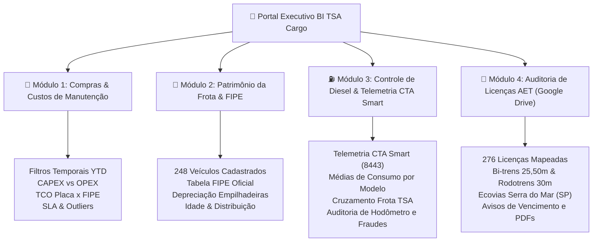

# 🚛 Portal Executivo BI & Telemetria — TSA Cargo / TSA Logística

[](https://script.google.com)
[](https://lucide.dev)
[](https://apexcharts.com)
[](https://script.google.com)

Sistema executivo de inteligência corporativa, gestão de compras, manutenção de frota, controle de combustível (diesel) com telemetria CTA Smart e auditoria de licenças especiais de trânsito (AET) desenvolvido para a diretoria da **TSA Cargo / TSA Logística**.

---

## 📌 Sumário Executivo & Módulos

O Portal é estruturado em **4 módulos estratégicos integrados**:



---

## 🛠️ Arquitetura dos Módulos

### 1. Compras & Custos de Manutenção (Módulo 1)
- **Base**: `153AuVXowt0wV1PArUpfHeFDJ2O_5Dy_PSwBl_k98nnw` (Google Sheets).
- **Recursos**:
  - Filtros avançados por Filial, Fornecedor, Status e Intervalo de Datas.
  - Sazonalidade de pedidos, gastos acumulados YTD e volumetria.
  - Classificação analítica de **CAPEX** (investimento) vs **OPEX** (operação/manutenção).
  - SLA de aprovação de pedidos e detecção de anomalias/outliers.

### 2. Patrimônio da Frota & Tabela FIPE Oficial (Módulo 2)
- **Base**: `1tRhBfK38m58vzoFmoxv8QWxjG6CYN66u7ozsE3RuI8Q` (Google Sheets).
- **Recursos**:
  - Cadastro de **248 veículos próprios** (Cavalos 6x4, Cavalos LS 4x2, Trucks, VUCs, Furgões, Carretas e Empilhadeiras).
  - Consulta automatizada da **Tabela FIPE Oficial** (`veiculos.fipe.org.br`).
  - Motor de cálculo de depreciação contábil para empilhadeiras e semirreboques sem código FIPE direto.
  - Gravação bidirecional direta na planilha do patrimônio.

### 3. Controle de Diesel & Telemetria CTA Smart (Módulo 3)
- **Base**: `1uZY3XdXKa4X_gphl0Rl_P2VS1ztogsXFX9AOlLP2-kU` (Google Sheets) + API CTA Smart.
- **Recursos**:
  - Integração oficial via API CTA Smart (Porta 8443) com acionador horário e botão de atualização em tempo real.
  - Classificador inteligente por modelo com **cruzamento prioritário na Frota TSA**:
    - **VUC Leve (Hyundai HR / Bongo)**: Meta de $8,00 \text{ a } 11,50\text{ km/L}$ (alvo $9,50\text{ km/L}$).
    - **Van / Furgão Leve (Fiat Ducato / Master / Sprinter)**: Meta de $8,00 \text{ a } 12,00\text{ km/L}$ (alvo $9,80\text{ km/L}$).
    - **Cavalos Traçados 6x4**: Meta de $1,70 \text{ a } 2,40\text{ km/L}$.
    - **Cavalos 4x2 / LS**: Meta de $2,30 \text{ a } 3,20\text{ km/L}$.
  - Auditoria automática de telemetria: detecção de hodômetro invertido/negativo, abastecimentos parciais e consumo crítico.

### 4. Auditoria de Licenças AET (Módulo 4)
- **Fonte**: Google Drive oficial TSA Cargo (`16NnsTxTEA9sAll4Z8wFnzUh4uxDgA0R8`).
- **Recursos**:
  - Auditoria completa de **276 licenças AET** ativas e arquivadas.
  - Matriz operacional de cavalos mecânicos aptos para:
    - **Bi-trem (25,50m)**
    - **Rodotrem (30,00m)**
    - **Ecovias Anchieta (Serra do Mar / SP)**
  - Semáforo de vigência: *Em Dia*, *A Vencer (≤ 30 dias)* e *Vencidas (Risco de Multa/Apreensão)*.
  - Acesso direto com 1 clique para visualização do PDF no Drive.

---

## 🎨 Identidade Visual Corporativa

O portal segue estritamente o manual de identidade visual da **TSA Cargo**:
- **Verde Institucional**: `#007A33` (Primário)
- **Vermelho Institucional**: `#E30613` (Acentos / Alertas)
- **Modo Escuro / Noturno**: Tema dark executivo com contraste otimizado para diretoria.
- **Modo Claro**: Disponível via toggle na barra superior.

---

## 📦 Estrutura dos Arquivos do Repositório

```text
├── Code.gs                          # Backend Google Apps Script (APIs, Google Sheets, Drive, CTA Smart)
├── Index.html                       # Frontend Single Page Application (HTML5, Tailwind-like CSS, Lucide, ApexCharts)
├── appsscript.json                  # Manifesto do projeto Apps Script (V8 runtime, WebApp permissions)
├── Painel_TSA_Diretoria_Preview.html # Versão standalone para visualização e testes locais
├── PUBLICAR_NO_APPS_SCRIPT.bat      # Script batch para deploy automatizado via Clasp
├── .clasp.json                      # Configuração de sincronização com o Google Apps Script
├── .claspignore                     # Arquivos ignorados no deploy do Apps Script
└── README.md                        # Documentação técnica e operacional completa
```

---

## 🚀 Histórico de Versões do Projeto (Google Apps Script)

| Versão | Data / Hora (UTC) | Descrição do Commit / Release |
| :---: | :---: | :--- |
| **V01** | `2026-10-28 13:28` | Inicialização do projeto Google Apps Script TSA Cargo |
| **V02** | `2026-10-28 18:44` | Painel Executivo Compras & Manutenção TSA Cargo |
| **V04** | `2026-10-28 19:07` | Painel Executivo Compras & Manutenção TSA Cargo (KPIs e Métricas) |
| **V06** | `2026-10-28 20:28` | Portal BI TSA Cargo — Módulo Compras & Manutenção + Módulo Patrimônio Frota |
| **V07** | `2026-10-28 20:58` | Portal BI TSA Cargo — Módulo Compras & Manutenção + Módulo Patrimônio Frota |
| **V09** | `2026-10-29 12:24` | Portal BI TSA Cargo — FIPE Oficial (veiculos.fipe.org.br) + Depreciação Empilhadeiras |
| **V10** | `2026-10-29 12:28` | Portal BI TSA Cargo — FIPE Oficial + Regra Depreciação Empilhadeiras |
| **V11..V20** | `2026-11-03` | Portal BI TSA Cargo — Compras 2026 YTD (Filtros Temporais, Sazonalidade, CAPEX/OPEX, SLA) |
| **V21..V23** | `2026-11-04` | Integração Módulo 3 (CTA Smart Sync API) e Módulo 4 (Auditoria AET Google Drive) |
| **V24..V27** | `2026-11-05` | Ajustes de telemetria CTA Smart, correção de mapeamento de odômetro e benchmarks |
| **V28** | `2026-11-05 20:41` | Correção definitiva médias HR/Ducato com cruzamento Frota TSA, remoção de código excedente e telemetria |

---

## 🔗 Links e Acessos

- **Repositório GitHub Oficial**: [https://github.com/klebercostabarros92-sketch/Portal-Executivo-BI-TSA-Cargo](https://github.com/klebercostabarros92-sketch/Portal-Executivo-BI-TSA-Cargo)
- **Branch Principal**: `master`
- **Ambiente de Produção (Web App)**: [Acessar Portal Executivo BI TSA Cargo](https://script.google.com/a/macros/tsacargo.com.br/s/AKfycbxqBnbvXBgED3UnzBnqxiuUt0fV6sHkNx3bjwoh5WVcfpNee4yksu60KlTQloDe5YHK/exec)
- **Ambiente de Desenvolvimento (@HEAD)**: [Acessar Ambiente Dev](https://script.google.com/a/macros/tsacargo.com.br/s/1N8ZLTuyyfmowpBIAIV2oMDbVQzb7AFB_WuHYXk5UUu7x5KXE2pNUKTvp/dev)
