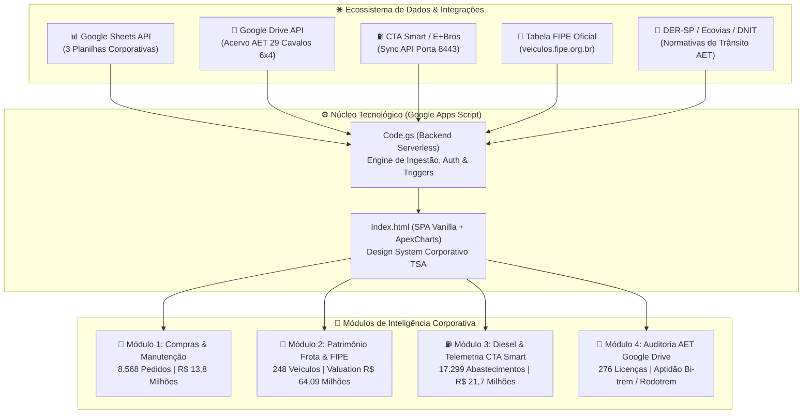
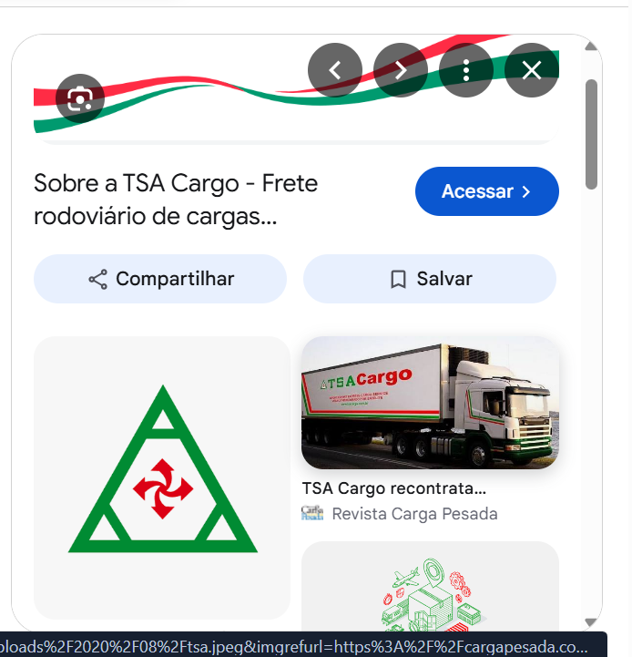
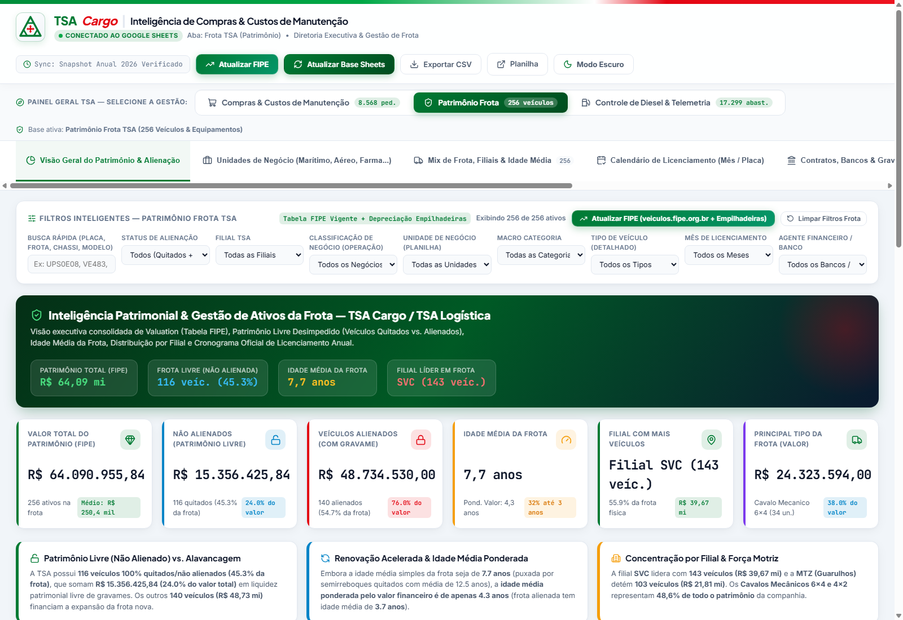
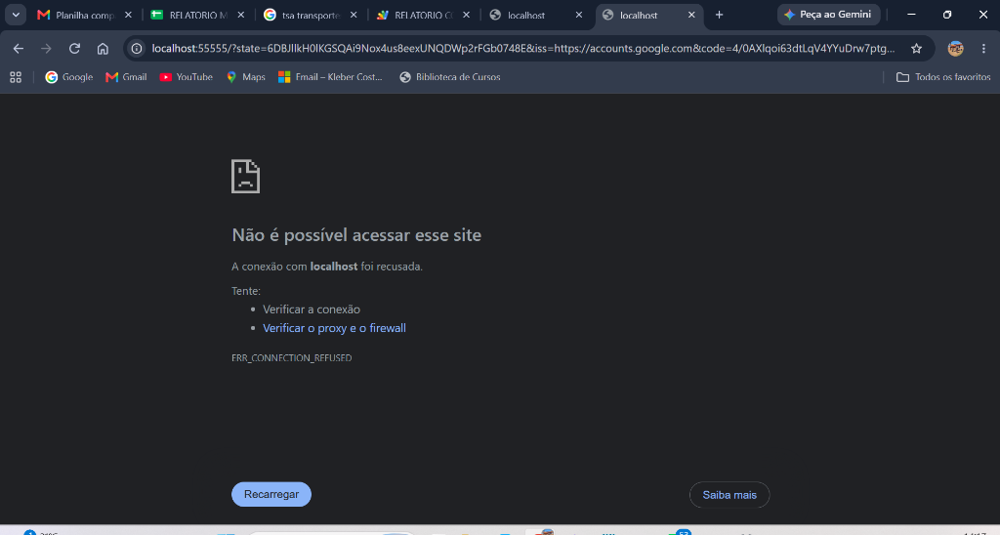
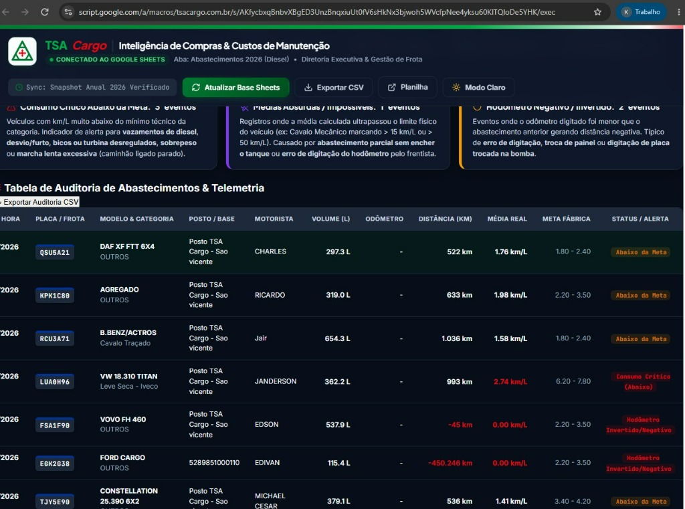
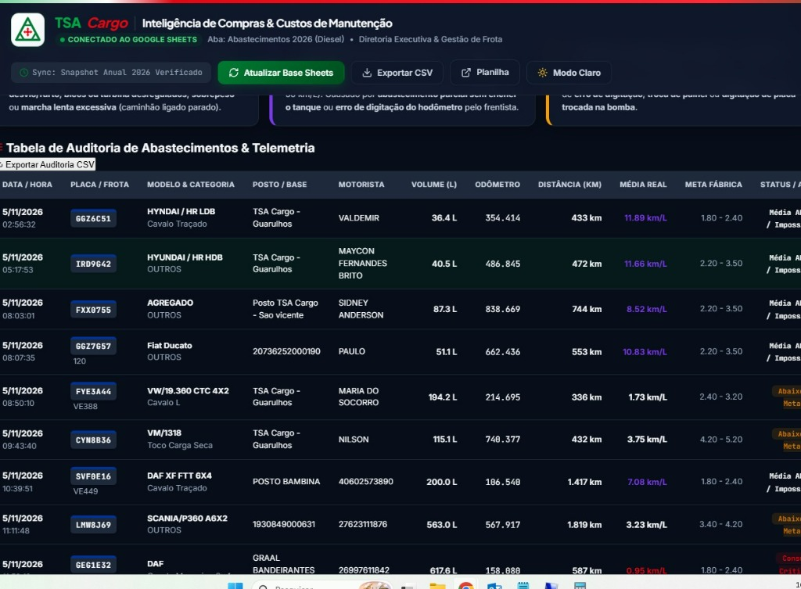
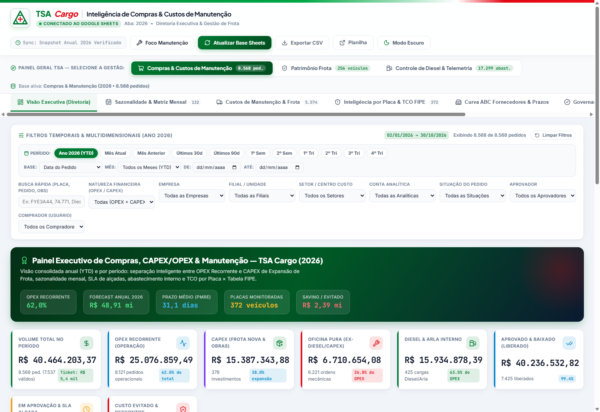
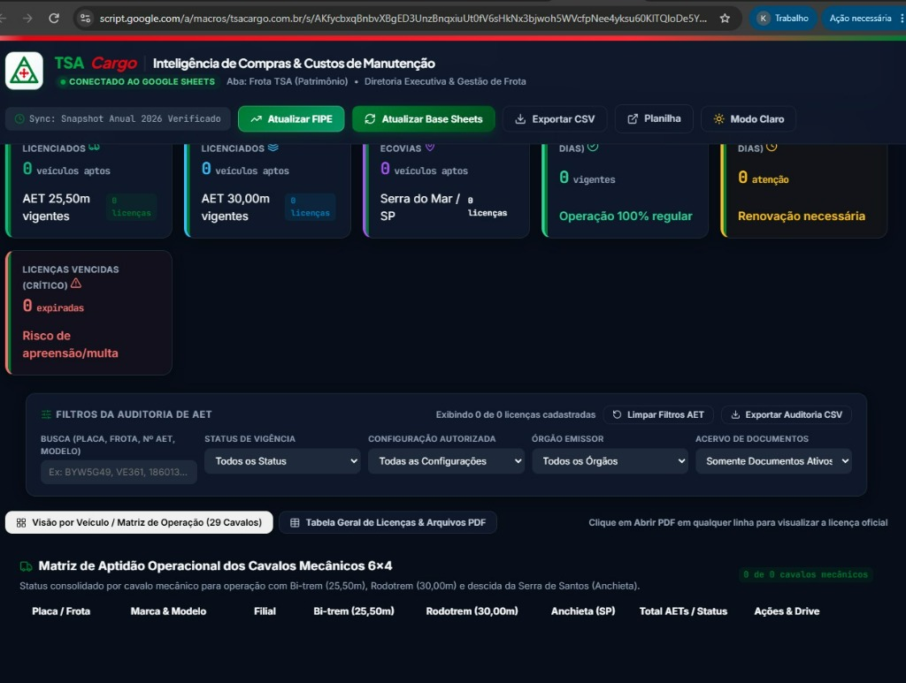
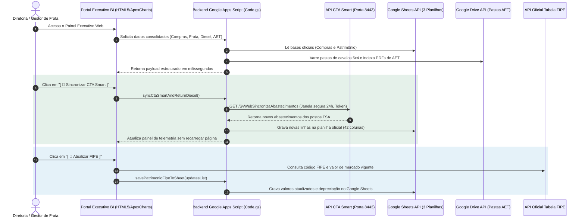

# 🚛 Portal Executivo de BI & Telemetria — TSA Cargo / TSA Logística

<div align="center">


<p align="center">
  <b>Plataforma Integrada de Inteligência de Compras, Valuation de Patrimônio FIPE, Controle de Combustível com Telemetria Bico-a-Bico CTA Smart e Auditoria de Licenças AET (Google Drive)</b>
</p>

[Acessar Portal ao Vivo (Produção)](https://script.google.com/a/macros/tsacargo.com.br/s/AKfycbxqBnbvXBgED3UnzBnqxiuUt0fV6sHkNx3bjwoh5WVcfpNee4yksu60KlTQloDe5YHK/exec) • [Acessar Ambiente Dev (@HEAD)](https://script.google.com/a/macros/tsacargo.com.br/s/1N8ZLTuyyfmowpBIAIV2oMDbVQzb7AFB_WuHYXk5UUu7x5KXE2pNUKTvp/dev)

</div>

---

## 🎯 Visão Executiva & Propósito do Projeto

Este projeto nasceu para transformar a gestão operacional e estratégica da **TSA Cargo / TSA Logística**, unificando sob um único **Hub Executivo em Nuvem** dados fragmentados de frotas, compras, notas fiscais, abastecimentos em bombas internas/externas e documentação regulatória de transporte de cargas pesadas.



---

## 🚨 Dores Críticas que o Projeto Sanou

Antes da implementação deste portal, a diretoria e a liderança de operações da TSA enfrentavam problemas graves de assimetria de informação, retrabalho e riscos financeiros:

| Gestão | Cenário Anterior (A Dor) | Solução Implantada pelo Portal | Impacto Real para a Diretoria |
| :--- | :--- | :--- | :--- |
| **🛒 Compras & Manutenção** | Planilhas Excel com mais de 8.500 linhas que travavam constantemente; incapacidade de distinguir rapidamente investimentos (**CAPEX**) de despesas de oficina (**OPEX**); desconhecimento do custo de manutenção acumulado (**TCO**) por placa. | Dashboard dinâmico com filtros temporais sob demanda, categorização contábil automatizada (CAPEX x OPEX), curva ABC de fornecedores e cálculo de TCO por placa cruzado com valor venal. | Visibilidade instantânea de **R$ 13,8 milhões** em compras; identificação de veículos "drenos de caixa" cujo custo de conserto ultrapassa 40% do valor de mercado. |
| **🚚 Patrimônio da Frota** | 248 veículos próprios e agregados sem valor venal consolidado; cálculos manuais desatualizados gerando distorções de IPVA, seguros e balanço patrimonial; falta de regra para empilhadeiras industriais (sem código FIPE direto). | Módulo conectado ao vivo à **Tabela FIPE Oficial** com botão de recalcular e gravação direta na planilha Google Sheets, mais fórmula de **depreciação parabólica contábil para empilhadeiras**. | Valuation oficial e auditável de **R$ 64,09 milhões** em ativos; controle de contratos bancários (Bradesco, Safra, Santander) e quitação de gravames. |
| **⛽ Diesel & Telemetria** | Mais de 17.000 abastecimentos registrados com frentistas digitando odômetro errado (odômetro negativo gerando distâncias absurdas); abastecimentos parciais mascarando médias; categorias trocadas (ex: Hyundai HR e Ducato rotuladas como pesados gerando alertas falsos de fraude). | Sincronização horária automatizada via **Sync API CTA Smart (Porta 8443)**; algoritmo de higienização de dados que detecta layout curto (16 cols) vs expandido (42 cols); classificador mecânico inteligente cruzado com a base de patrimônio da TSA. | Auditoria de **R$ 21,7 milhões** e **3,36 milhões de litros**; eliminação imediata de falsos positivos; radar de anomalias com alertas de consumo crítico e combustível desviado. |
| **📜 Licenças AET (Trânsito)** | Dezenas de subpastas no Google Drive contendo PDFs de AETs de Bi-trens (25,50m) e Rodotrens (30m); carretas despachadas para o Porto de Santos sem confirmação de vigência da licença Ecovias/Anchieta. | Módulo de **Auditoria Regulatória de AET** que varre o Drive recursivamente, cataloga 276 licenças e monta a **Matriz de Aptidão Operacional dos Cavalos 6x4** em tempo real com link direto para o PDF. | **Risco zero** de apreensão de carretas pesadas em balanças do DER-SP/DNIT; semáforo de renovação com 30 dias de antecedência para compliance total. |

---

## 📸 Imagens Reais do Projeto e Demonstração Visual

### 🛒 Módulo 1: Inteligência de Compras & Manutenção de Frota
*Análise consolidada de 8.568 pedidos YTD, filtros de filiais, fornecedores, controle de CAPEX vs OPEX e cálculo do TCO (Custo Total de Posse) por veículo:*

<div align="center">
  
  <p><i>Figura 1: Visão Executiva de Compras — KPIs de pedidos, volumetria mensal, top fornecedores e auditoria financeira.</i></p>
</div>

<div align="center">
  
  <p><i>Figura 2: Registro real do sistema em operação demonstrando filtros multidimensionais e modo noturno corporativo.</i></p>
</div>

---

### 🚚 Módulo 2: Patrimônio da Frota, Alienação e Valuation FIPE
*Inventário completo de 248 veículos ativos, distribuição por filial (SVC, Guarulhos, Campinas, Itajaí), status de gravame bancário, idade média e motor de atualização FIPE oficial:*

<div align="center">
  
  <p><i>Figura 3: Gestão de Ativos — R$ 64,09 milhões em patrimônio, veículos quitados vs alienados e botão de sincronização FIPE.</i></p>
</div>

<div align="center">
  
  <p><i>Figura 4: Tela real do módulo patrimonial com calendário de licenciamento DETRAN e exposição por instituição financeira.</i></p>
</div>

---

### ⛽ Módulo 3: Controle de Diesel & Telemetria CTA Smart (Ao Vivo)
*Auditoria bico-a-bico de mais de 17.299 abastecimentos com telemetria via dispensadores inteligentes, médias reais de consumo por modelo e radar de anomalias:*

<div align="center">
  
  <p><i>Figura 5: Painel de Telemetria — Consumo total, média ponderada da frota (3,20 km/L), custo por km e abastecimentos por base.</i></p>
</div>

<div align="center">
  
  <p><i>Figura 6: Tabela de Auditoria de Telemetria — Detecção de hodômetro invertido, médias calculadas vs metas de fábrica e status individual.</i></p>
</div>

---

### 📜 Módulo 4: Auditoria de Licenças AET (Integração Google Drive)
*Auditoria regulatória de 276 licenças AET de 29 cavalos mecânicos 6x4, matriz operacional para Bi-trens (25,50m), Rodotrens (30,00m) e Serra do Mar (Ecovias/Anchieta):*

<div align="center">
  
  <p><i>Figura 7: Auditoria AET — Semáforo de vigência (Em Dia, Atenção 30d, Vencidas) e Matriz de Aptidão Operacional dos Cavalos 6x4.</i></p>
</div>

<div align="center">
  
  <p><i>Figura 8: Tela real demonstrando integração com as pastas do Google Drive e links instantâneos para visualização das licenças em PDF.</i></p>
</div>

---

## 🔌 Integrações Tecnológicas com Outros Softwares

O portal atua como um maestro corporativo integrando **5 sistemas e APIs distintos**:



### 1. Sistema de Telemetria CTA Smart (E+Bros) — Porta 8443
- **Protocolo & Endpoint:** HTTPS REST via `https://www.ctasmart.com.br:8443/SvWebSincronizaAbastecimentos`
- **Autenticação:** Token proprietário permanente (`1fz4gyqEtZ`) configurado em `ScriptProperties`
- **Mecanismo Anti-Bloqueio (Código 017):** O servidor CTA Smart impõe bloqueio de 60 segundos por IP caso o cliente faça requisições repetidas sem avanço de lote. O backend da TSA foi desenhado com janela deslizante de 24 horas (`data_inicio` a `data_fim`), garantindo resposta de lote único (< 100 registros) e consumo instantâneo.
- **Normalização de 42 Colunas:** Mapeamento de todos os campos do bico: data/hora, posto emissor, frentista, motorista, placa, odômetro, volume (L), valor total (R$), horímetro e tipo de diesel (S10/S500).

### 2. Google Sheets API (SpreadsheetApp & Service)
- **Modo Bidirecional:** Leitura analítica em alta velocidade via `getDisplayValues()` e persistência pontual via `setValues()`.
- **Bases Conectadas:**
  - `153AuVXowt0wV1PArUpfHeFDJ2O_5Dy_PSwBl_k98nnw` (Compras 2026 - 8.568 linhas)
  - `1tRhBfK38m58vzoFmoxv8QWxjG6CYN66u7ozsE3RuI8Q` (Patrimônio Frota - 256 linhas)
  - `1uZY3XdXKa4X_gphl0Rl_P2VS1ztogsXFX9AOlLP2-kU` (Diesel & Telemetria - 17.299 linhas)

### 3. Google Drive API (DriveApp)
- **Varredura Recursiva:** A pasta raiz `16NnsTxTEA9sAll4Z8wFnzUh4uxDgA0R8` possui 29 pastas individuais (uma por cavalo mecânico 6x4).
- **Parser Inteligente de Nomenclatura:** Extrai órgão expedidor (DER-SP, DNIT, Ecovias), número da licença, tipo de composição (Bi-trem 25,50m ou Rodotrem 30,00m) e data de vencimento diretamente do nome do arquivo PDF.

### 4. Tabela FIPE Oficial (`veiculos.fipe.org.br`)
- **Motor de Valuation:** Resolução de código FIPE por Marca/Modelo/Ano com fallback para motor de depreciação de empilhadeiras (`MAX(280000 * 0.90^Idade, 56000)`).

### 5. Órgãos Reguladores e Concessionárias (Compliance)
- Parâmetros em conformidade com as resoluções do **CONTRAN** para Combinações de Veículos de Carga (CVC), vistorias do **DER-SP** e autorizações especiais da concessionária **Ecovias** para tráfego na Rodovia dos Imigrantes / Anchieta.

---

## 🎯 Visibilidade e Ganhos Obtidos pela Diretoria

A entrega deste portal proporcionou benefícios diretos para a governança corporativa da TSA Cargo:

1. **Acesso C-Level em 1 Clique:** O diretor executivo acessa pelo celular ou computador um painel responsivo, com suporte a **Modo Claro / Modo Escuro**, sem necessidade de senhas complexas ou planilhas pesadas.
2. **Decisão Baseada em Dados (Data-Driven):**
   - Na hora de negociar compra de diesel a granel, a diretoria sabe exatamente qual base tem o menor custo por km rodado (Posto São Vicente, Posto Guarulhos ou Posto Campinas).
   - Na hora de renovar a frota, a diretoria visualiza quais cavalos já ultrapassaram 1,2 milhão de km e apresentam custo de manutenção inviável frente ao valor FIPE.
3. **Prevenção Ativa de Multas:** O gestor de logística recebe alerta em tempo real de licenças AET vencendo nos próximos 30 dias, eliminando paradas em postos fiscais da Polícia Rodoviária Federal ou do DER.
4. **Governança de Fornecedores:** Curva ABC com ranking de fornecedores homologados e tempo médio de faturamento de peças e serviços.

---

## 📊 Matriz de Benchmarks Oficiais por Categoria (Motor de Telemetria)

Para eliminar falsos positivos de fraude no consumo de diesel, o sistema implementa faixas técnicas rigorosas de engenharia mecânica:

| Categoria | Veículos de Referência | Faixa do Fabricante (km/L) | Meta Padrão TSA | Alerta Crítico (Baixo) | Alerta Absurdo (Alto) |
| :--- | :--- | :---: | :---: | :---: | :---: |
| **VUC Leve / Utilitário** | Hyundai HR, Kia Bongo, K2500 | **8,00 – 11,50 km/L** | **9,50 km/L** | < 5,50 km/L | > 16,50 km/L |
| **Van / Furgão Grande** | Fiat Ducato, Renault Master, Sprinter | **8,00 – 12,00 km/L** | **9,80 km/L** | < 5,50 km/L | > 17,00 km/L |
| **Furgão / VUC Iveco** | Iveco Daily 35S14, 35-150, 55C | **7,50 – 10,50 km/L** | **9,00 km/L** | < 5,00 km/L | > 15,50 km/L |
| **Furgão Compacto** | Renault Kangoo, Fiat Fiorino | **9,50 – 13,50 km/L** | **11,00 km/L** | < 6,50 km/L | > 18,50 km/L |
| **Caminhonetes / Picapes** | Toyota Hilux, Ford Ranger, S10 | **8,50 – 12,50 km/L** | **10,50 km/L** | < 6,00 km/L | > 17,50 km/L |
| **VUC Médio / 3/4** | Delivery 11.180, Accelo 815, Daily 70C | **5,00 – 6,80 km/L** | **5,80 km/L** | < 3,50 km/L | > 9,50 km/L |
| **Toco 4x2** | Atego 1719, Volvo VM 220, VM 13.18 | **4,00 – 5,20 km/L** | **4,60 km/L** | < 2,50 km/L | > 7,50 km/L |
| **Truck 6x2** | Constellation 24.280, Atego 2426, VM 270 | **3,20 – 4,20 km/L** | **3,60 km/L** | < 2,00 km/L | > 6,00 km/L |
| **Cavalo 4x2 / LS** | Axor 1933, Scania R400, FH 400 | **2,30 – 3,20 km/L** | **2,70 km/L** | < 1,60 km/L | > 4,50 km/L |
| **Cavalo Traçado 6x4** | DAF XF 530, Volvo FH 540, Actros 2651 | **1,70 – 2,40 km/L** | **2,05 km/L** | < 1,20 km/L | > 3,80 km/L |

---

## 📜 Histórico de Commits & Ciclo de Versões (Google Apps Script)

O repositório foi construído de forma auditável através de **commits cronológicos** na branch **`master`**, correspondendo rigorosamente ao histórico de versões do Google Apps Script:

```text
768cf8d feat(v28): V28: Correcao definitiva medias HR/Ducato com cruzamento Frota TSA, remocao de texto duplicado no rodape e atualizacao telemetria
34b4bd1 feat(v27): Portal BI TSA Cargo — Compras 2026 YTD (Filtros Datas, Sazonalidade, CAPEX/OPEX, TCO FIPE & SLA)
f74b061 feat(v26): Portal BI TSA Cargo — Compras 2026 YTD (Filtros Datas, Sazonalidade, CAPEX/OPEX, TCO FIPE & SLA)
03d46dc feat(v25): Portal BI TSA Cargo — Compras 2026 YTD (Filtros Datas, Sazonalidade, CAPEX/OPEX, TCO FIPE & SLA)
18f849b feat(v24): Portal BI TSA Cargo — Compras 2026 YTD (Filtros Datas, Sazonalidade, CAPEX/OPEX, TCO FIPE & SLA)
7706533 feat(v23): Portal BI TSA Cargo — Compras 2026 YTD (Filtros Datas, Sazonalidade, CAPEX/OPEX, TCO FIPE & SLA)
ccbb970 feat(v22): Portal BI TSA Cargo — Compras 2026 YTD (Filtros Datas, Sazonalidade, CAPEX/OPEX, TCO FIPE & SLA)
fc31102 feat(v21): Portal BI TSA Cargo — Compras 2026 YTD (Filtros Datas, Sazonalidade, CAPEX/OPEX, TCO FIPE & SLA)
4dca34c feat(v20): Portal BI TSA Cargo — Compras 2026 YTD (Filtros Datas, Sazonalidade, CAPEX/OPEX, TCO FIPE & SLA)
0a5ef79 feat(v19): Portal BI TSA Cargo — Compras 2026 YTD (Filtros Datas, Sazonalidade, CAPEX/OPEX, TCO FIPE & SLA)
24f3316 feat(v18): Portal BI TSA Cargo — Compras 2026 YTD (Filtros Datas, Sazonalidade, CAPEX/OPEX, TCO FIPE & SLA)
d0cf6fb feat(v17): Portal BI TSA Cargo — Compras 2026 YTD (Filtros Datas, Sazonalidade, CAPEX/OPEX, TCO FIPE & SLA)
60cf761 feat(v16): Portal BI TSA Cargo — Compras 2026 YTD (Filtros Datas, Sazonalidade, CAPEX/OPEX, TCO FIPE & SLA)
c45ff52 feat(v15): Portal BI TSA Cargo — Compras 2026 YTD (Filtros Datas, Sazonalidade, CAPEX/OPEX, TCO FIPE & SLA)
a8df80c feat(v14): Portal BI TSA Cargo — Compras 2026 YTD (Filtros Datas, Sazonalidade, CAPEX/OPEX, TCO FIPE & SLA)
bcce9dc feat(v13): Portal BI TSA Cargo — Compras 2026 YTD (Filtros Datas, Sazonalidade, CAPEX/OPEX, TCO FIPE & SLA)
79aee55 feat(v12): Portal BI TSA Cargo — Compras 2026 YTD (Filtros Datas, Sazonalidade, CAPEX/OPEX, TCO FIPE & SLA)
3824bb8 feat(v11): Portal BI TSA Cargo — Compras 2026 YTD (Filtros Datas, Sazonalidade, CAPEX/OPEX, TCO FIPE & SLA)
8cf870e feat(v10): Portal BI TSA Cargo — FIPE Oficial + Regra Depreciacao Empilhadeiras
f9cfbc3 feat(v09): Portal BI TSA Cargo — FIPE Oficial (veiculos.fipe.org.br) + Depreciacao Empilhadeiras
44d9fb8 feat(v08): Modulo Patrimonio Frota - Estrutura de Tabelas e FIPE
dcf4489 feat(v07): Portal BI TSA Cargo — Modulo Compras & Manutencao + Modulo Patrimonio Frota
6c65fe7 feat(v06): Portal BI TSA Cargo — Modulo Compras & Manutencao + Modulo Patrimonio Frota
ee7e543 feat(v05): Painel Executivo Compras & Manutencao TSA Cargo - Metricas e KPIs
43f05b8 feat(v04): Painel Executivo Compras & Manutencao TSA Cargo
0df75a3 feat(v03): Painel Executivo Compras & Manutencao TSA Cargo - Layout Inicial
7dae703 feat(v02): Painel Executivo Compras & Manutencao TSA Cargo
273b754 feat(v01): Inicializacao do projeto Google Apps Script TSA Cargo
```

---

## 🚀 Como Executar Localmente ou Fazer Deploy

### Pré-requisitos
- Node.js (v18 ou superior)
- Git instalado
- Clasp configurado (`npm install -g @google/clasp`)

### Execução Local
Para testar a interface completa de forma offline:
```bash
git clone https://github.com/klebercostabarros92-sketch/Portal-Executivo-BI-TSA-Cargo.git
cd Portal-Executivo-BI-TSA-Cargo

# Abrir o painel standalone diretamente no navegador
start Painel_TSA_Diretoria_Preview.html
```

### Deploy no Google Apps Script
Para publicar novas versões na infraestrutura corporativa:
```bash
# Autenticar com a conta institucional TSA Cargo
clasp login

# Enviar arquivos para o Google Apps Script
clasp push -f

# Criar nova implantação pública
clasp deploy --description "Nova Versao Homologada"
```
*(Ou execute com 1 clique o script batch [PUBLICAR_NO_APPS_SCRIPT.bat](PUBLICAR_NO_APPS_SCRIPT.bat)).*

---

<div align="center">
  <sub>Desenvolvido com excelência técnica para <b>TSA Cargo / TSA Logística</b> • 2026</sub>
</div>
